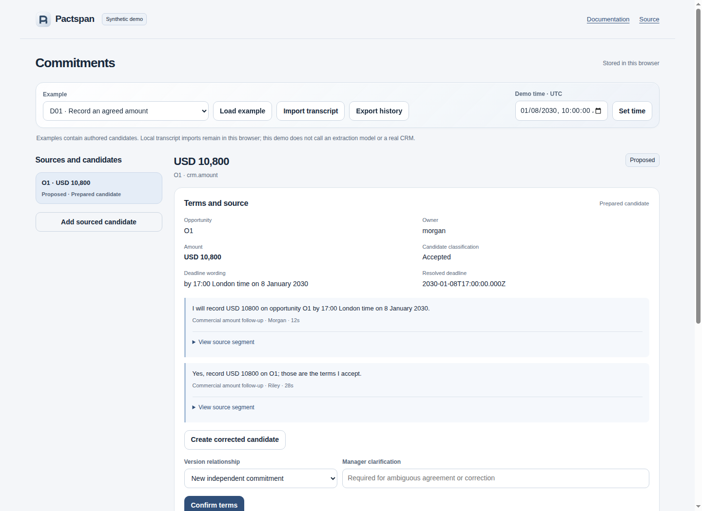

# Pactspan

Track meeting commitments as confirmed versions with source quotes, explicit amendments and CRM verification receipts. A write acknowledgment leaves a commitment unverified; a fresh matching reader observation can fulfill its current version.



## Try the synthetic demo

Requires Node 22 or newer. No dependency installation, model or CRM account is needed.

```sh
node scripts/serve-demo.mjs
```

Open the printed loopback URL. With **D01** selected:

1. Review the quotes and confirm the terms.
2. Read the Demo CRM, approve the exact amount change and execute that approval.
3. Verify CRM state with a separate read. The acknowledgment alone creates no receipt.
4. Expand the Demo CRM editor, change its amount, then verify again. The commitment becomes disputed and keeps its earlier receipt.

This browser demo uses authored candidates and a separate mutable synthetic CRM. It calls no extraction model or real CRM. Imports stay in the browser; export history before replacing a workspace.

## Run a persistent local workspace

```sh
node src/cli.mjs serve --example D01
```

Open the printed numeric loopback URL. Data survives restarts in `.pactspan/`. Omit `--example` when restarting: that option explicitly replaces the synthetic workspace. Only one process can open a data directory.

For a [release package](https://github.com/bglglzd/pactspan/releases), extract `pactspan-0.1.0.tgz` into an empty directory, enter `package/` and run the same command. No npm install is required. The release manifest records source, toolchain and SHA256 digests. `node src/cli.mjs help` lists server, action-file and export commands.

For an EspoCRM sandbox, set `PACTSPAN_CRM_ORIGIN` and `PACTSPAN_SINGLE_WRITER=1`, then provide separate reader/writer keys in a private file with `reader.apiKey` and `writer.apiKey`:

```sh
node src/cli.mjs serve --crm espocrm --data .pactspan/espo --keys /private/api-identities.json
```

Keys stay server-side. The exercised adapter is **EspoCRM 10.0.12 Opportunity amount/currency**, in a dedicated single-writer sandbox. Native `X-Version-Number` is a pre-save check rather than atomic database compare-and-swap. See [configuration, recovery and limits](docs/local-operation.md).

## Review imported terms

Import timestamped JSON/TXT, inspect its source and add a sourced candidate. Confirm it separately. Corrections create a new unconfirmed candidate and retain the original quotes, candidate and model run. Replacing confirmed terms requires an explicit version link; unresolved conflicts block action.

Optional local extraction uses an OpenAI-compatible server configured through `PACTSPAN_MODEL_ORIGIN` and `PACTSPAN_MODEL`. It is **experimental and unreliable**: the first held-out run had **0/11 exact commitment matches**, with 18 predictions and 11 rejected as unsupported. Every term needs human review; enter missing candidates manually. Raw predictions and failures remain exportable. There is no automatic confirmation, write, retry or paid fallback. [Measured results](docs/evaluation-results.md) · [Pinned inference setup](docs/local-inference.md).

Approvals are one-use, expiring and bound to the exact version, target, prior revision and payload. Uncertain writes block further writes until reconciliation or explicit operator recovery. A fresh receipt must match the current version and predicate. Proposal dispatch and other generic promises remain tracked without a fulfillment adapter; a matching CRM amount does not prove they happened.

The [thirty synthetic manual journeys](docs/dataset.md) cover amendments, refusal, missing ownership, prerequisites, conflicting currencies, replay and rollback. Their passing domain results are separate from automatic extraction quality.

[Specification](docs/spec.md) · [Architecture](docs/architecture.md) · [Data contract](docs/dataset-contract.md) · [Contributing](CONTRIBUTING.md) · [MIT license](LICENSE)
