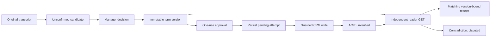

# Architecture plan

One JavaScript domain library runs in modern browsers and Node22+. Plain HTML/CSS/ES modules provide the UI; a small loopback Node server and CLI provide durable local operation and credentialed adapters. Runtime dependencies remain proportionate; no shared portfolio framework or duplicated browser/Python state machine is introduced.

Boundaries:

- `src/core/`: strict data validation, canonical hashes, immutable sources/versions, transitions, approvals, verification and invariants. No network or filesystem calls.
- `src/core/source.mjs`: Auris segment JSON and timestamped TXT into the canonical source representation.
- `src/adapters/`: separate mutable Demo CRM, actual EspoCRM reader/writer, and actual schema-constrained local extraction. Adapters cannot bypass domain guards.
- `src/local/`: serialized durable store with atomic replacement/dead-owner lock recovery, loopback HTTP boundary and decision controller. `src/cli.mjs` starts the server or executes a JSON action file. Persist attempts before external writes; re-read/reconcile uncertain outcomes.
- `public/`: original SVG, functional UI and static demo using the same core and explicitly synthetic adapter. No embedded credentials, private transcripts or automatic remote calls.
- `examples/development/`: predeclared bilingual sources/annotations; held-out data is sealed outside the product until the first frozen evaluation.

Node/browser Web Crypto supplies SHA256. A content hash does not authenticate a CRM action. The live server obtains observations itself rather than accepting a client-supplied fulfillment receipt. Persistent application data and secrets are ignored and excluded from packages/demo archives.

The domain store uses a nonce-owned process lock, checksum envelope, file fsync and atomic rename. Stale owners are preserved as tombstones; a corrupt current file never falls back to an older state automatically. On Windows, sudden power-loss durability of the renamed directory entry is not claimed. A failed commit freezes further decisions in that server process; restart validates the current file. This includes ambiguous failures after a successful rename.

The controller serializes decisions and external writes. Approval obtains its own reader observation and compares it with the reviewed before-state. Execution commits a pending attempt before calling the adapter; the returned ACK never creates a receipt. Verification and reconciliation obtain their own new reads. Synthetic CRM persistence uses a separate file; resetting an example explicitly replaces both synthetic stores and is not a distributed transaction.

The loopback UI uses a per-process session token, strict numeric Host and same-origin mutations, no CORS, bounded JSON requests and a closed action dispatcher. Credentials, adapter origins and model configuration come from the local operator. Sources/model outputs cannot select endpoints or invoke raw writes. Static hosting has no session token or network capability and keeps its browser-only demonstration.

Buildless static output is copied into `dist/` with relative paths for GitHub Pages. The release manifest binds the source, toolchain/configuration and tested package/demo digests. The package and static ZIP contain the public allowlist; workspace data, credentials and operational evidence are excluded. [Measured results](evaluation-results.md) distinguish the domain journeys from experimental model suggestions and state their workload and machine.
